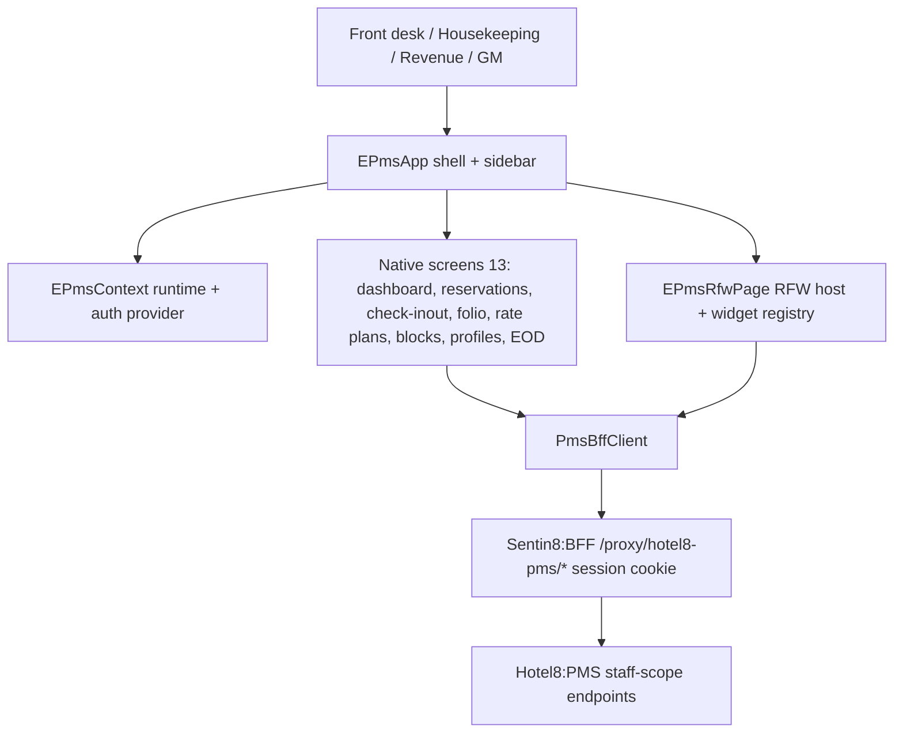

# Hotel8:ePMS

## 1. Summary

Hotel8:ePMS is the hotel staff PMS application - a Flutter app giving
front-desk agents, housekeeping, revenue and general managers the property
management surface: reservations, room status, check-in/out, folios, rate
plans, blocks, profiles, and End-of-Day. Unlike the guest apps, ePMS
bootstraps the Sentin8:App runtime context and staff BFF session itself
(`app_context.dart`), and hosts RFW-rendered operations pages alongside its
native screens.

## 2. Motivation

Front-office operations need speed and density: arrivals lists, drag-easy room
assignment, folio drilling, EOD exceptions. ePMS gives hotel8 that staff
console natively against Hotel8:PMS over the BFF with staff-realm identity -
the same contract layer the service's RFW admin pages use, so native screens
and RFW-rendered pages render from one authorization surface instead of a
separate vendor PMS UI.

## 3. Architecture & High-Level Design

The bootstrap is real platform integration: `fetchRuntimeContext(appBaseUrl)`
resolves org/env/auth/BFF domains from the App runtime-context endpoint (TLS
injects `X-Sentin8-*` host headers), `EPmsContext` owns the `BffAuthProvider`
(staff realm, session check, web redirect callback), and every API call flows
through the single `PmsBffClient` against `/proxy/hotel8-pms/v1/...`.

## 4. Key Traits and Data Structures

* `EPmsContext` (`app_context.dart`) - the app's runtime spine: holds
  `AppRuntimeContext` + `BffAuthProvider`, constructs the `PmsBffClient`,
  and exposes both to the tree via `InheritedWidget`/`ChangeNotifier`.
* `EPmsRfwPage` (`rfw/ops_page.dart`) - the RFW rendering host: fetches
  `GET /v1/admin/ui/{page}` through the proxy, renders with the shared SDK
  renderer, handles data/submit endpoints and page navigation.
* `epmsWidgetHosts` (`rfw/widget_hosts.dart`) - the native-widget registry
  (DatePicker, DateRangePicker, TimePicker, DateTimePicker, OccupancyGauge,
  RoomStatusGrid, FolioViewer, RoomAssignmentPicker, BlockStatusTracker,
  CalendarView) that RFW `Native` widgets resolve through; each host reads
  `props` and writes back via `onValueChanged` (the RFW form-binding
  contract).
* `PmsBffClient` - typed wrappers over the `/proxy/hotel8-pms/v1/properties/
  {propertyId}/...` surface (dashboard, reservations + actions, housekeeping,
  folio charges/payments, rate plans + schedules, blocks, profiles, EOD,
  audit, availability/inventory, split, events).
* Models - `Dashboard`, `Arrival`/`Departure`, `Reservation`, `RoomStatus`,
  `Folio`/`FolioItem`, `RatePlan`/`RateSchedule`, `Block`, `Event`,
  `Profile`, `ServiceRequest`, `Task`, `AuditLog`, `ReportData` - the staff
  projections of PMS contract rows.

## 5. Rationale, Trade-offs, and Alternatives

* **Native screens + RFW host, deliberately hybrid.** The PMS admin surface
  is RFW-first (`/v1/admin/ui/*` rendered by Dash); ePMS hosts the same
  definitions in-app for staff workflows that need shell-level chrome, and
  keeps dense daily-use screens native for performance. Rejected: full RFW
  (all screens rendered) - drops the tuned native dashboard/grid; full native
  - duplicates every admin page the service already exposes.
* **Custom widget registry in-app, not in the SDK** - domain-flavored hosts
  (room status grid, folio viewer) stay app-local per the platform rule that
  only generic primitives would be SDK candidates; the registry is passed
  into the renderer, not monkey-patched onto it.
* **Runtime context + auth in `app_context.dart`** - one provider object for
  the tree keeps bootstrap failures explicit (an error screen, not a blank
  page) and the session-aware client in one place. Rejected: global
  singletons (untestable, hides bootstrap order).
* **Cookie session, no tokens in-app** - the browser holds the BFF session
  cookie; tokens never reach the client (BFF token-guardian pattern).

## 6. Internal Implementation & Invariants (Private Design)

* **Invariants:**
  * All API paths are rooted at `/proxy/hotel8-pms/v1/properties/{propertyId}`;
    `propertyId` is the runtime context's environment id (tenant identity by
    construction) and is threaded into every screen.
  * The RFW host fetches definitions each time a page mounts (in-memory, no
    disk cache); stale definitions cannot outlive navigation.
  * RFW form submissions go to `/v1/admin/{resource}` via `postRawJson`;
    page navigation inside the RFW host rewrites `_rfwIndex`, keeping the
    native sidebar active state correct.
  * Widget hosts are pure UI: props in, `onValueChanged` out, data through the
    RFW-declared endpoint (`dataEndpoint`) - no domain logic, no hardcoded
    endpoints.
  * Auth state changes notify the shell (`auth.addListener`); dispose
    removes the listener and closes the provider (no leaked notifier).
* Web redirects for sign-in/out go through `window.location.href` (the SDK
  callback contract), preserving full-page round-trips to the auth domain.
* Semantics are enabled at bootstrap (`ensureSemantics`) for the Playwright
  E2E suite's ARIA access.

## 7. Unresolved Questions / Future Designs

* Property identity currently reuses the environment id; a property registry
  read (`GET /v1/properties?env_id=...`) would lift the assumption when
  multi-property-per-env lands.
* RFW host caching (TTL validation) and role-gated page access are designed
  for but not yet implemented in the host.
* The staff sign-in/sign-up screens ride the shared auth provider; the
  session timeout/re-auth UX for sensitive operations is not yet designed.

---

**Design attribution:** hotel8:epms and its underlying concepts were designed by Hamid Jahanzad <Hamid@Jahanzad.com>.
